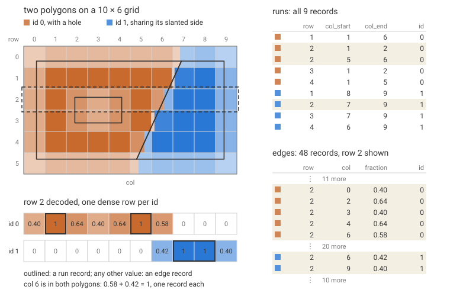
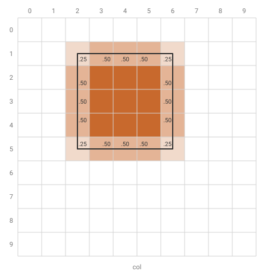
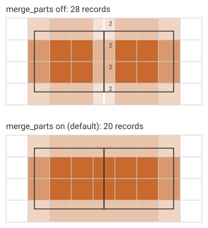

# The contract

A burn takes geometries and a grid and returns four tables. This chapter
starts with what those tables look like for two polygons, and the rules
for reading them, then works through one square on a 10 x 10 grid where
every number can be checked by hand.

## What a burn produces



Two polygons on a 10 x 6 grid: id 0 has a hole, and id 1 shares id 0's
slanted side. The burn gives 9 runs and 48 edges. A run says that a
stretch of one row is fully inside a polygon; an edge gives the fraction
of one cell that a polygon covers, where its boundary crosses the cell.
Row 2 (dashed) has records of both kinds. Decoded into one dense row per
polygon, id 0 has two runs either side of its hole, with the hole's three
boundary cells between them as edges. Column 6 is crossed by the side the
two polygons share, so it has an edge for each: 0.58 for id 0 and 0.42
for id 1, adding up to the whole cell.

Decoding is all there is to the format. Here it is for the figure, one
dense layer per id:

```rust
# extern crate controlledburn;
use controlledburn::{burn, BurnOptions, Coord, Geometry, GridSpec, Polygon};

let ring = |v: &[(f64, f64)]| v.iter().map(|&(x, y)| Coord::new(x, y)).collect::<Vec<_>>();
let geoms = [
    // id 0, with a hole
    Geometry::Polygon(Polygon::new(vec![
        ring(&[(0.6, 0.7), (5.3, 0.7), (7.4, 5.3), (0.6, 5.3), (0.6, 0.7)]),
        ring(&[(2.4, 2.4), (2.4, 3.6), (4.6, 3.6), (4.6, 2.4), (2.4, 2.4)]),
    ])),
    // id 1, sharing id 0's slanted side
    Geometry::Polygon(Polygon::new(vec![ring(&[(5.3, 0.7), (9.4, 0.7), (9.4, 5.3), (7.4, 5.3), (5.3, 0.7)])])),
];
let grid = GridSpec::new(0.0, 0.0, 10.0, 6.0, 10, 6);
let r = burn(&geoms, &grid, BurnOptions::default()).unwrap();
assert_eq!((r.runs.len(), r.edges.len()), (9, 48));

// One dense layer per id, 0 where there is no record.
let ncol = grid.ncol as usize;
let mut layers = vec![vec![0.0f32; ncol * grid.nrow as usize]; geoms.len()];
for run in &r.runs {
    let at = run.row as usize * ncol;
    layers[run.id as usize][at + run.col_start as usize..at + run.col_end as usize].fill(1.0);
}
for e in &r.edges {
    layers[e.id as usize][e.row as usize * ncol + e.col as usize] = e.fraction;
}

let row2 = |id: usize| layers[id][2 * ncol..3 * ncol].iter().map(|v| format!("{v:.2}")).collect::<Vec<_>>().join(" ");
println!("{}", row2(0)); // 0.40 1.00 0.64 0.40 0.64 1.00 0.58 0.00 0.00 0.00
println!("{}", row2(1)); // 0.00 0.00 0.00 0.00 0.00 0.00 0.42 1.00 1.00 0.40
# assert_eq!(row2(0), "0.40 1.00 0.64 0.40 0.64 1.00 0.58 0.00 0.00 0.00");
# assert_eq!(row2(1), "0.00 0.00 0.00 0.00 0.00 0.00 0.42 1.00 1.00 0.40");
assert!((layers[0][2 * ncol + 6] + layers[1][2 * ncol + 6] - 1.0).abs() < 1e-6);
```

A dense layer per id is only for showing the format: it is the size of
the grid for every geometry. [`materialize`](materialize.md) folds all
ids into one buffer with a pixel function (the sum of coverage, the id
covering most of the cell, and so on), one window at a time.

## Reading the tables

- **A cell in no record is 0.** Nothing of any geometry falls in it.
  Most of a grid is in no record, which is why the tables are small.
- **One record per cell for each id.** For one geometry a cell is in a
  run, or has one edge, or has neither, never both (with `merge_parts`
  on, the default; see [below](#multi-part-geometries)).
- **A cell can have a record for each of several ids.** Neighbours that
  share a border each get an edge in the cells it crosses, and where
  they tile a cell their fractions add up to 1. Overlapping geometries
  each get their own records too. The tables are per geometry, not per
  cell.
- **Records are in order.** Each table is grouped by id, in input
  order; within an id, runs and edges (and lines) are in row-major
  order, by row and then by column. Points are in the order the geometry
  lists them, one record per point. Every burn function gives this
  order, and `crop` and `slice_tiles` keep it.
- **Approx mode gives runs only.** The cell-centre rule has no partial
  cells, so `edges` is empty ([Coverage versus approx](coverage-vs-approx.md)).

```rust
# extern crate controlledburn;
# use controlledburn::{burn, BurnOptions, Coord, Geometry, GridSpec, Polygon};
# let ring = |v: &[(f64, f64)]| v.iter().map(|&(x, y)| Coord::new(x, y)).collect::<Vec<_>>();
# let geoms = [
#     Geometry::Polygon(Polygon::new(vec![
#         ring(&[(0.6, 0.7), (5.3, 0.7), (7.4, 5.3), (0.6, 5.3), (0.6, 0.7)]),
#         ring(&[(2.4, 2.4), (2.4, 3.6), (4.6, 3.6), (4.6, 2.4), (2.4, 2.4)]),
#     ])),
#     Geometry::Polygon(Polygon::new(vec![ring(&[(5.3, 0.7), (9.4, 0.7), (9.4, 5.3), (7.4, 5.3), (5.3, 0.7)])])),
# ];
# let grid = GridSpec::new(0.0, 0.0, 10.0, 6.0, 10, 6);
# let r = burn(&geoms, &grid, BurnOptions::default()).unwrap();
// The order, as keys that only ever increase:
assert!(r.runs.windows(2).all(|w| (w[0].id, w[0].row, w[0].col_start) < (w[1].id, w[1].row, w[1].col_start)));
assert!(r.edges.windows(2).all(|w| (w[0].id, w[0].row, w[0].col) < (w[1].id, w[1].row, w[1].col)));
```

The order means a binding can read the records of one id as one slice,
or a row of one id with a binary search, without sorting first.

Each table is a `Vec` of a plain `#[repr(C)]` struct with `i32` indices
and, where there is a measure, an `f32`. Indices are 0-based, row 0 is
the top row, and run ranges are half-open, the conventions of Rust,
Python, C and Arrow; a binding for a 1-based language adds 1 at its
boundary.

| table | fields | one record means |
|---|---|---|
| `runs` | `row, col_start, col_end, id` | cells `col_start..col_end` on `row` are fully inside geometry `id` |
| `edges` | `row, col, fraction, id` | geometry `id` covers `fraction` of cell `(row, col)`, with `0 < fraction < 1` |
| `lines` | `row, col, length, id` | geometry `id` has `length` units of line inside cell `(row, col)` |
| `points` | `row, col, id` | geometry `id` has a point in cell `(row, col)` |

Geometry `k` in the input slice has `id = k` in every table, so the
tables join back to whatever attributes came with the geometries by
position. (`BurnOptions::with_id_offset(n)` makes it `n + k`, for burns
of consecutive slices that are concatenated.) `notes` is a fifth table,
of per-geometry problems (unparseable WKB, non-finite coordinates, rings
or lines too short to burn) that do not stop the burn.

## One square, by hand

The same tables for one square on a 10 x 10 grid, placed so that every
boundary cell is exactly a half or a quarter covered.

### Input

A grid is an extent plus a column and row count; the cell size follows.
Row 0 is the top row, as in every raster format.

```rust
# extern crate controlledburn;
use controlledburn::{burn, BurnOptions, Coord, Geometry, GridSpec, Polygon};

let grid = GridSpec::new(0.0, 0.0, 10.0, 10.0, 10, 10);
assert_eq!((grid.dx(), grid.dy()), (1.0, 1.0));

// A 4 x 4 square whose corners sit at cell centres, so every boundary
// cell is exactly half (sides) or a quarter (corners) covered.
let square = Geometry::Polygon(Polygon::new(vec![vec![
    Coord::new(2.5, 4.5),
    Coord::new(6.5, 4.5),
    Coord::new(6.5, 8.5),
    Coord::new(2.5, 8.5),
    Coord::new(2.5, 4.5),
]]));

let r = burn(&[square], &grid, BurnOptions::default()).unwrap();
# assert_eq!(r.runs.len(), 3);
# assert_eq!(r.edges.len(), 16);
```


### Output

`runs` holds the fully covered cells as half-open column ranges,
`col_start..col_end`, so `col_end - col_start` is the run length and
`buffer[col_start..col_end]` is its slice:

```rust
# extern crate controlledburn;
# use controlledburn::{burn, BurnOptions, Coord, Geometry, GridSpec, Polygon};
# let grid = GridSpec::new(0.0, 0.0, 10.0, 10.0, 10, 10);
# let square = Geometry::Polygon(Polygon::new(vec![vec![Coord::new(2.5, 4.5), Coord::new(6.5, 4.5), Coord::new(6.5, 8.5), Coord::new(2.5, 8.5), Coord::new(2.5, 4.5)]]));
# let r = burn(&[square], &grid, BurnOptions::default()).unwrap();
for run in &r.runs {
    println!("row {} cols {}..{} id {}", run.row, run.col_start, run.col_end, run.id);
}
// row 2 cols 3..6 id 0
// row 3 cols 3..6 id 0
// row 4 cols 3..6 id 0
# assert_eq!(r.runs.iter().map(|x| (x.row, x.col_start, x.col_end)).collect::<Vec<_>>(), vec![(2, 3, 6), (3, 3, 6), (4, 3, 6)]);
```

`edges` holds the boundary cells with the fraction of each cell's area
that the polygon covers:

```rust
# extern crate controlledburn;
# use controlledburn::{burn, BurnOptions, Coord, Geometry, GridSpec, Polygon};
# let grid = GridSpec::new(0.0, 0.0, 10.0, 10.0, 10, 10);
# let square = Geometry::Polygon(Polygon::new(vec![vec![Coord::new(2.5, 4.5), Coord::new(6.5, 4.5), Coord::new(6.5, 8.5), Coord::new(2.5, 8.5), Coord::new(2.5, 4.5)]]));
# let r = burn(&[square], &grid, BurnOptions::default()).unwrap();
let corners = r.edges.iter().filter(|e| e.fraction == 0.25).count();
let sides = r.edges.iter().filter(|e| e.fraction == 0.5).count();
assert_eq!((corners, sides), (4, 12));
```

`lines` and `points` are empty for polygon input; they are the subject
of a [later chapter](lines-and-points.md). `notes` is empty too.



### The invariant

Add up the run cells and the edge fractions, multiply by the cell area,
and you have the polygon's area. This holds for any polygon that lies
inside the grid, and it is what "exact coverage" means:

```rust
# extern crate controlledburn;
# use controlledburn::{burn, BurnOptions, Coord, Geometry, GridSpec, Polygon};
# let grid = GridSpec::new(0.0, 0.0, 10.0, 10.0, 10, 10);
# let square = Geometry::Polygon(Polygon::new(vec![vec![Coord::new(2.5, 4.5), Coord::new(6.5, 4.5), Coord::new(6.5, 8.5), Coord::new(2.5, 8.5), Coord::new(2.5, 4.5)]]));
# let r = burn(&[square], &grid, BurnOptions::default()).unwrap();
let run_cells = r.run_cells() as f64;                       // 9
let edge_cells: f64 = r.edges.iter().map(|e| e.fraction as f64).sum(); // 4 * 0.25 + 12 * 0.5 = 7
let area = (run_cells + edge_cells) * grid.dx() * grid.dy();
assert_eq!(area, 16.0);
```

The same holds for an arbitrary triangle on a grid with awkward cell
sizes, to floating-point precision:

```rust
# extern crate controlledburn;
use controlledburn::{burn, signed_area, BurnOptions, Coord, Geometry, GridSpec, Polygon};

let ring = vec![Coord::new(13.3, 17.7), Coord::new(88.1, 22.4), Coord::new(41.9, 79.2), Coord::new(13.3, 17.7)];
let exact = signed_area(&ring).abs();
let grid = GridSpec::new(0.0, 0.0, 100.0, 100.0, 37, 41);
let r = burn(&[Geometry::Polygon(Polygon::new(vec![ring]))], &grid, BurnOptions::default()).unwrap();
let burned = r.covered_cells() * grid.dx() * grid.dy();
assert!((burned - exact).abs() / exact < 1e-5, "{burned} vs {exact}");
```

## Multi-part geometries

A multi-polygon gets one record per cell, as if it were one polygon
(`merge_parts`, on by default). Where two parts meet inside a cell, their
fractions are added, and two halves make a whole cell, so the cell
becomes part of a run. With `merge_parts` off each part keeps its own
records, which is what the C++ core gives:



```rust
# extern crate controlledburn;
use controlledburn::{burn, BurnOptions, Coord, Geometry, GridSpec, Polygon};

let rect = |x0: f64, x1: f64| Polygon::new(vec![vec![
    Coord::new(x0, 0.6), Coord::new(x1, 0.6), Coord::new(x1, 3.4), Coord::new(x0, 3.4), Coord::new(x0, 0.6),
]]);
let g = Geometry::MultiPolygon(vec![rect(1.3, 4.5), rect(4.5, 7.7)]);
let grid = GridSpec::new(0.0, 0.0, 9.0, 4.0, 9, 4);

let off = burn(std::slice::from_ref(&g), &grid, BurnOptions::default().with_merge_parts(false)).unwrap();
let on = burn(std::slice::from_ref(&g), &grid, BurnOptions::default()).unwrap();
assert_eq!(off.runs.len() + off.edges.len(), 28);
assert_eq!(on.runs.len() + on.edges.len(), 20);
assert!((on.covered_cells() - off.covered_cells()).abs() < 1e-5);
```

Parts are added, not unioned: parts that overlap are capped at a full
cell, but the overlap is not subtracted from a partial one.
`BurnOptions::parity` turns merging off along with run coalescing.
With merging off, a multi-part geometry's records also come part by
part: each part's in row-major order, then the next part's.

## Precision

The measures are `f32` on purpose. Each is computed in `f64` and
rounded when the record is written, so a fraction is good to about
6e-8 of its cell, on any grid; the sum over a polygon is good to about
1e-7 relative. `f32` keeps an edge record at 16 bytes rather than 24,
and edges are most of a coverage result. A caller that needs `f64`
fractions over a window has `CoverageWindow`, or `RowPrefix` for
prefix sums.

That is the whole contract. There is no raster object, no CRS, no
attribute handling, and no I/O: those belong to whatever wraps the
crate.
