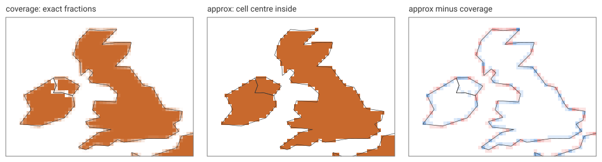

# Coverage versus approx

A burn has to answer one question at every boundary cell: how much of
this cell is the polygon? The crate offers two answers.

- `BurnMode::Coverage` (the default) gives the exact fraction of the
  cell's area, as an edge record.
- `BurnMode::Approx` gives all or nothing: the cell is inside if its
  centre is. This is the rule GDAL, fasterize and most rasterizers use.
  There are no edges, only runs, so the tables are smaller and quicker to
  make.

On a square the difference is easy to state:

```rust
# extern crate controlledburn;
use controlledburn::{burn, BurnOptions, Coord, Geometry, GridSpec, Polygon};

let grid = GridSpec::new(0.0, 0.0, 10.0, 10.0, 10, 10);
let square = Geometry::Polygon(Polygon::new(vec![vec![
    Coord::new(2.5, 4.5), Coord::new(6.5, 4.5), Coord::new(6.5, 8.5), Coord::new(2.5, 8.5), Coord::new(2.5, 4.5),
]]));
let exact = burn(std::slice::from_ref(&square), &grid, BurnOptions::coverage()).unwrap();
let approx = burn(std::slice::from_ref(&square), &grid, BurnOptions::approx()).unwrap();
assert_eq!(exact.covered_cells(), 16.0);   // 9 full + 16 partial cells
assert_eq!(approx.run_cells(), 16);        // 16 full cells, no edges
assert!(approx.edges.is_empty());
```

Both say 16 cells, the square's true area, though approx gets there by
counting 16 whole cells where only 9 are whole. On a coastline the two
part company. Here are Britain and Ireland at a quarter of a degree:



Every boundary cell is a guess under approx. The right panel is approx
minus coverage: blue where the centre rule claims more of a cell than the
polygon covers, red where it claims less. The errors are as large as a
whole cell, but they run in both directions along the coast, so over a
large country they mostly cancel: the United Kingdom is 547.25 cells by
coverage and 549 by approx.

## Small countries

Cancelling needs many boundary cells. A country that spans only a few
cells has nothing to cancel against, and the centre rule can make it
vanish or double it. On the world at one degree:

```rust
# extern crate controlledburn;
use controlledburn::{burn_wkb, BurnOptions, GridSpec};
# let data_dir = env!("CONTROLLEDBURN_BOOK_DATA");
# let bytes = std::fs::read(format!("{data_dir}/ne_110m_countries.wkb")).unwrap();
# fn split_blobs(bytes: &[u8]) -> Vec<&[u8]> { let n = u32::from_le_bytes(bytes[0..4].try_into().unwrap()) as usize; let mut pos = 4; let mut out = Vec::with_capacity(n); for _ in 0..n { let len = u32::from_le_bytes(bytes[pos..pos + 4].try_into().unwrap()) as usize; pos += 4; out.push(&bytes[pos..pos + len]); pos += len; } out }
# let countries = split_blobs(&bytes);
# let csv = std::fs::read_to_string(format!("{data_dir}/ne_110m_countries.csv")).unwrap();
# let names: Vec<String> = csv.lines().skip(1).map(|l| l.split(',').nth(1).unwrap().trim_matches('"').to_string()).collect();
# let id = |name: &str| names.iter().position(|n| n == name).unwrap() as i32;

let grid = GridSpec::new(-180.0, -90.0, 180.0, 90.0, 360, 180);
let cov = burn_wkb(countries.iter().copied(), &grid, BurnOptions::coverage()).unwrap();
let app = burn_wkb(countries.iter().copied(), &grid, BurnOptions::approx()).unwrap();

// Cells of one country under each rule.
let cells = |r: &controlledburn::BurnResult, id: i32| -> f64 {
    let runs: i32 = r.runs.iter().filter(|x| x.id == id).map(|x| x.col_end - x.col_start).sum();
    let edges: f64 = r.edges.iter().filter(|e| e.id == id).map(|e| e.fraction as f64).sum();
    runs as f64 + edges
};

# // The quarter-degree grid of the figure: the United Kingdom.
# let uk = GridSpec::new(-11.0, 49.5, 2.5, 59.5, 54, 40);
# let c = burn_wkb(countries.iter().copied(), &uk, BurnOptions::coverage()).unwrap();
# let a = burn_wkb(countries.iter().copied(), &uk, BurnOptions::approx()).unwrap();
# assert!((cells(&c, id("United Kingdom")) - 547.25).abs() < 0.01);
# assert_eq!(cells(&a, id("United Kingdom")), 549.0);
// The whole world agrees to 0.2%...
assert!((app.run_cells() as f64 / cov.covered_cells() - 1.0).abs() < 0.002);
// ...but Luxembourg and Cyprus vanish, and the Gambia is 2.6 times too big.
assert_eq!(cells(&app, id("Luxembourg")), 0.0);
assert_eq!(cells(&app, id("Cyprus")), 0.0);
assert!((cells(&cov, id("Luxembourg")) - 0.30).abs() < 0.01);
assert!((cells(&cov, id("Gambia")) - 1.17).abs() < 0.01);
assert_eq!(cells(&app, id("Gambia")), 3.0);

// At 0.1 degree Luxembourg is still 7% short.
let fine = GridSpec::new(-180.0, -90.0, 180.0, 90.0, 3600, 1800);
let cov = burn_wkb(countries.iter().copied(), &fine, BurnOptions::coverage()).unwrap();
let app = burn_wkb(countries.iter().copied(), &fine, BurnOptions::approx()).unwrap();
assert!((cells(&cov, id("Luxembourg")) - 30.15).abs() < 0.01);
assert_eq!(cells(&app, id("Luxembourg")), 28.0);
```

A finer grid shrinks the problem without removing it: at 0.1 degree
Luxembourg is still 7% short under approx (28 cells against 30.15).
Coverage is exact at any resolution, so the area of a small zone or a
zonal mean over it (see [Zonal statistics](zonal.md)) does not depend on
how the grid happens to fall on the coast.

Approx is still the right choice when the result is a mask, when the
output must match another tool that uses the centre rule, or when only
the runs are wanted: it skips the fraction computation and gives fewer
records.

[playproj: rasterize](https://hypertidy.github.io/playproj/rasterize.html)
shows the same comparison interactively, on world countries and
coastlines in several projections.
