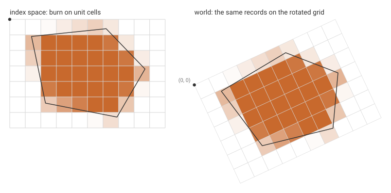

# Grids beyond the lattice

`burn` works on a regular lattice: cells of one size, lined up with the
axes of the grid's coordinates. Plenty of grids are not like that. Some
are rotated, some have uneven spacing along an axis, and some are
curvilinear, with each cell its own quadrilateral.

None of them needs a different engine. Each grid has an **index space**,
where cell `(row, col)` is the unit square from `col` to `col + 1` and
`row` to `row + 1`. Move the polygon into index space, burn it on a
lattice of unit cells, and the records already name the original grid's
rows and columns:



On a rotated grid the move into index space is the inverse of the
grid's geotransform, applied to each vertex. A rotation keeps areas, so
the fractions are fractions of world area too, and the sum is the
polygon's area in cells:

```rust
# extern crate controlledburn;
use controlledburn::{burn, signed_area, BurnOptions, Coord, Geometry, GridSpec, Polygon};

// A 10 x 7 grid of unit cells, rotated 25 degrees, origin at (2, 0).
let (ncol, nrow) = (10u32, 7u32);
let t = 25f64.to_radians();
let (u, v) = ((t.cos(), t.sin()), (t.sin(), -t.cos())); // along a row, down a column
let world = |col: f64, row: f64| Coord::new(2.0 + col * u.0 + row * v.0, col * u.1 + row * v.1);
let ring = vec![world(1.4, 1.1), world(6.2, 0.6), world(8.7, 3.2), world(6.9, 6.3), world(2.3, 5.4), world(1.4, 1.1)];

// Into index space: project onto u and v. Rows count down, so y = -row.
let index: Vec<Coord> = ring.iter().map(|c| {
    let (dx, dy) = (c.x - 2.0, c.y);
    Coord::new(dx * u.0 + dy * u.1, -(dx * v.0 + dy * v.1))
}).collect();
let lattice = GridSpec::new(0.0, -(nrow as f64), ncol as f64, 0.0, ncol, nrow);
let r = burn(&[Geometry::Polygon(Polygon::new(vec![index]))], &lattice, BurnOptions::default()).unwrap();

// Each record's (row, col) is a cell of the rotated grid; the areas agree.
assert!((r.covered_cells() - signed_area(&ring).abs()).abs() < 1e-5);
```

The same idea covers the other kinds of grid. What changes is how the
polygon gets into index space, and whether the fractions are still
fractions of world area:

| grid | into index space | result |
|---|---|---|
| regular | none | exact |
| rotated or sheared affine | inverse geotransform on the vertices | exact |
| rectilinear (uneven 1D coordinates) | cut edges at cell walls, map each axis | exact |
| curvilinear, equal-area cells | cut edges at cell sides and four spokes per cell | exact |
| curvilinear, bilinear cells (GDAL geolocation) | densify, inverse lookup | close (about 1% of a cell on a polar sector) |

Longitude that wraps around, and the folds of tripolar ocean grids, are
unwrapped into a wider index space and folded back afterwards, with
`merge_cells` to restore one record per cell. For longitude/latitude
grids, `Measure::cos_latitude` gives spherical cell areas to weight the
fractions.

These front ends live outside the crate: the curvilinear one is in
[rwarp](https://github.com/hypertidy/rwarp). The contract they work
to, and the measurements behind the table, are in
[`design/grid-frontends.md`](https://github.com/hypertidy/controlledburn-rs/blob/main/design/grid-frontends.md).
