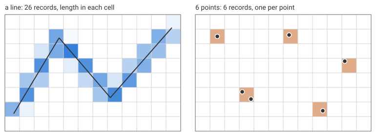

# Lines and points

Lines and points go into the same tables as polygons, in the same shape:
a row, a column, an id, and for lines a measure.

- A line gives one `lines` record per cell it passes through, with the
  length of line inside that cell, in the grid's units.
- A point gives one `points` record: the cell it falls in. Two points in
  one cell are two records; nothing is counted or merged for you.

The burn mode does not matter for either; coverage and approx give the
same records.



The figure's line crosses 26 cells, and its lengths add up to the
line's length. Its six points give six records, two of them in one cell:

```rust
# extern crate controlledburn;
use controlledburn::{burn, BurnOptions, Coord, Geometry, GridSpec};

let grid = GridSpec::new(0.0, 0.0, 12.0, 8.0, 12, 8);
let coords = vec![
    Coord::new(0.6, 1.2), Coord::new(3.7, 6.4), Coord::new(7.2, 2.3), Coord::new(11.4, 7.1),
];
let length: f64 = coords.windows(2).map(|w| (w[1].x - w[0].x).hypot(w[1].y - w[0].y)).sum();
let line = Geometry::LineString(coords);
let r = burn(&[line], &grid, BurnOptions::default()).unwrap();
assert_eq!(r.lines.len(), 26);
assert!((r.line_length() - length).abs() < 1e-4);

let points = Geometry::MultiPoint(vec![
    Coord::new(1.5, 6.5), Coord::new(3.2, 2.7), Coord::new(3.8, 2.2),
    Coord::new(6.4, 6.6), Coord::new(8.7, 1.4), Coord::new(10.2, 4.8),
]);
let r = burn(&[points], &grid, BurnOptions::default()).unwrap();
assert_eq!(r.points.len(), 6);
assert_eq!((r.points[1].row, r.points[1].col), (r.points[2].row, r.points[2].col));
```

A multi-line geometry whose parts cross the same cell gets one record
there, with the parts' lengths summed (`merge_parts`, on by default; see
[the contract](contract.md#multi-part-geometries)). Lengths are planar,
in the units of the grid's coordinates; for a longitude/latitude grid
they are in degrees.
