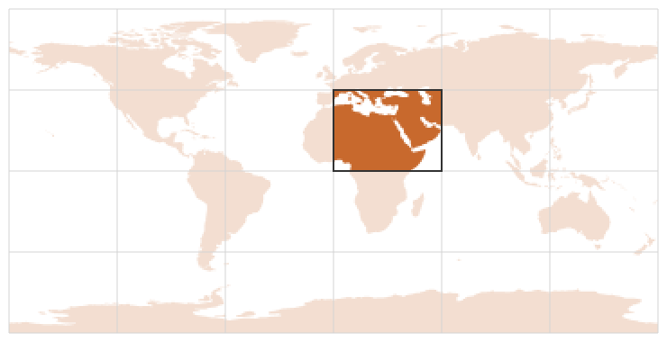

# Materialize, chunk by chunk

`materialize` turns tables into pixels: it writes each record into a
dense buffer, combining several geometries in one pixel with a
`PixelFn` (first, last, sum, min, max, count or any) and treating
boundary cells by an `EdgePolicy` (the fraction times the value, or all
or nothing at a threshold).

```rust
# extern crate controlledburn;
use controlledburn::{burn, materialize, BurnOptions, Coord, Geometry, GridSpec, MaterializeOptions};
# use controlledburn::Polygon;

let grid = GridSpec::new(0.0, 0.0, 10.0, 10.0, 10, 10);
let square = Geometry::Polygon(Polygon::new(vec![vec![
    Coord::new(2.5, 4.5), Coord::new(6.5, 4.5), Coord::new(6.5, 8.5), Coord::new(2.5, 8.5), Coord::new(2.5, 4.5),
]]));
let r = burn(&[square], &grid, BurnOptions::default()).unwrap();
let mut pixels = vec![f64::NAN; 100];
materialize(&r, &mut pixels, 10, 10, None, &MaterializeOptions::default()).unwrap();
// The default is a threshold at 0.5: the 9 run cells and the 12 side cells.
assert_eq!(pixels.iter().filter(|v| !v.is_nan()).count(), 21);
```

The buffer does not have to be the whole grid. Burn once, then cut out
one window with [`crop`](crop.md) and materialize only that. This is
how a chunked format such as Zarr is written without ever holding the
full raster: the 0.01-degree world of the
[sparse versus dense](sparse-vs-dense.md) chapter is 5 GB dense, and
never needs to exist in memory.



Here the world at one degree is burned once and one 60 by 45 degree tile
is made dense, 2,700 pixels of the grid's 64,800:

```rust
# extern crate controlledburn;
use controlledburn::{burn_wkb, crop, materialize, BurnOptions, EdgePolicy, GridSpec, MaterializeOptions, PixelFn};
# let data_dir = env!("CONTROLLEDBURN_BOOK_DATA");
# let bytes = std::fs::read(format!("{data_dir}/ne_110m_countries.wkb")).unwrap();
# fn split_blobs(bytes: &[u8]) -> Vec<&[u8]> { let n = u32::from_le_bytes(bytes[0..4].try_into().unwrap()) as usize; let mut pos = 4; let mut out = Vec::with_capacity(n); for _ in 0..n { let len = u32::from_le_bytes(bytes[pos..pos + 4].try_into().unwrap()) as usize; pos += 4; out.push(&bytes[pos..pos + len]); pos += len; } out }
# let countries = split_blobs(&bytes);

let grid = GridSpec::new(-180.0, -90.0, 180.0, 90.0, 360, 180);
let r = burn_wkb(countries.iter().copied(), &grid, BurnOptions::default()).unwrap();

let (tile, sub) = crop(&r, &grid, [0.0, 0.0, 60.0, 45.0]).unwrap();
assert_eq!((sub.ncol, sub.nrow), (60, 45));

// Land fraction per pixel: every geometry's coverage, summed.
let mut land = vec![f64::NAN; (sub.ncol * sub.nrow) as usize];
let ones = vec![1.0; countries.len()];
let opts = MaterializeOptions::new(PixelFn::Sum, EdgePolicy::Fraction);
materialize(&tile, &mut land, sub.ncol, sub.nrow, Some(&ones), &opts).unwrap();
// 1,788 records become 2,272 pixels with some land, 2,046 cells of land in all.
assert_eq!(tile.runs.len() + tile.edges.len(), 1788);
assert_eq!(land.iter().filter(|v| !v.is_nan()).count(), 2272);
let total: f64 = land.iter().filter(|v| !v.is_nan()).sum();
assert!((total - 2046.36).abs() < 0.01);
```

For many tiles, [`slice_tiles`](crop.md#many-tiles-slice_tiles) cuts
the result into a whole tile grid in one pass, and each tile is
materialized the same way.
