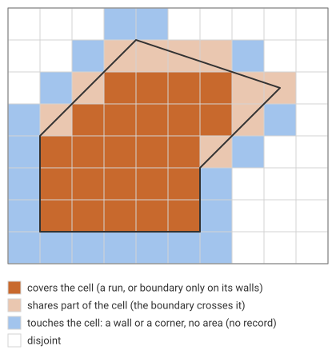

# Predicates per cell

A burn is a lookup table. To ask whether a point is in a polygon, find
the point's cell. If the cell is in a run, the answer is yes. If the cell
has no record, it is no. Only an edge cell needs the polygon itself, and
there are far fewer of those than cells overall. That is much faster than
testing the point against every polygon's rings.

`relate_cells` takes the same idea from points to cells and from "inside"
to every spatial predicate. For each polygon and each cell it gives the
**DE-9IM matrix**: nine entries saying how the polygon's interior,
boundary and exterior meet the cell's interior, boundary and exterior
(each `F` for empty, or the dimension `0`, `1` or `2` of the
intersection). From the matrix come *covers*, *intersects*, *touches* and
any other named predicate.

## Most cells are already answered

A cell the polygon's boundary does not reach is either wholly inside the
polygon or wholly outside it, and the burn already says which: a run, or
no record. So `relate_cells` only computes the matrix for the cells whose
closed box the boundary touches, from the geometry, and needs only the
segments near each of them. Every other cell is
`IntersectionMatrix::COVERED` (`212FF1FF2`) or `DISJOINT` (`FF2FF1212`).



The polygon in the figure has edges along cell walls and diagonals
through cell corners. Its boundary touches 43 cells:

```rust
# extern crate controlledburn;
use controlledburn::{burn, relate_cells, BurnOptions, Coord, Geometry, GridSpec, Polygon};

let grid = GridSpec::new(0.0, 0.0, 10.0, 8.0, 10, 8);
let ring = [(1.0, 1.0), (6.0, 1.0), (6.0, 3.0), (8.5, 5.5), (4.0, 7.0), (1.0, 4.0), (1.0, 1.0)];
let geoms = [Geometry::Polygon(Polygon::new(vec![ring.iter().map(|&(x, y)| Coord::new(x, y)).collect()]))];

let opts = BurnOptions::default();
let r = burn(&geoms, &grid, opts).unwrap();
let rel = relate_cells(&r, &geoms, &grid, opts).unwrap();   // same options as the burn

assert_eq!(rel.len(), 43);
let covers = rel.iter().filter(|c| c.matrix.covers()).count();
let partial = rel.iter().filter(|c| c.matrix.interiors_meet() && !c.matrix.covers()).count();
let touches = rel.iter().filter(|c| c.matrix.touches()).count();
assert_eq!((covers, partial, touches), (13, 10, 20));

// A cell below the bottom edge, which lies on its top wall: they share a
// line (BB = 1) and no area.
let below = rel.iter().find(|c| (c.row, c.col) == (7, 2)).unwrap();
assert_eq!(below.matrix.as_str(), "FF2F11212");
// The cell above it: covered, with the boundary along its bottom wall.
let above = rel.iter().find(|c| (c.row, c.col) == (6, 2)).unwrap();
assert_eq!(above.matrix.as_str(), "212F11FF2");
// A cell the top vertex touches at its corner: one point in common.
let corner = rel.iter().find(|c| (c.row, c.col) == (0, 3)).unwrap();
assert_eq!(corner.matrix.as_str(), "FF2F01212");
```

The 20 touching cells, half along a wall and half at a corner, have no
record in the burn: no part of their area is covered. So the records
alone cannot give an exact *all-touched* set, every cell the polygon
meets even at a single point. With the relations it is the runs plus
every related cell that `intersects()`: here 11 runs the boundary does
not reach, plus 43, so 54 cells against the 34 cells that have a record.

```rust
# extern crate controlledburn;
# use controlledburn::{burn, relate_cells, BurnOptions, Coord, Geometry, GridSpec, Polygon};
# let grid = GridSpec::new(0.0, 0.0, 10.0, 8.0, 10, 8);
# let ring = [(1.0, 1.0), (6.0, 1.0), (6.0, 3.0), (8.5, 5.5), (4.0, 7.0), (1.0, 4.0), (1.0, 1.0)];
# let geoms = [Geometry::Polygon(Polygon::new(vec![ring.iter().map(|&(x, y)| Coord::new(x, y)).collect()]))];
# let opts = BurnOptions::default();
# let r = burn(&geoms, &grid, opts).unwrap();
# let rel = relate_cells(&r, &geoms, &grid, opts).unwrap();
use std::collections::BTreeSet;

let mut touched: BTreeSet<(i32, i32)> = rel.iter().filter(|c| c.matrix.intersects()).map(|c| (c.row, c.col)).collect();
for run in &r.runs {
    touched.extend((run.col_start..run.col_end).map(|col| (run.row, col)));
}
assert_eq!(touched.len(), 54);
assert_eq!(r.run_cells() as usize + r.edges.len(), 34);
```

## Any cell's matrix

The relations and the runs together answer for every cell. Keep the
relations in a map, and the rest is the lookup from the start of the
chapter:

```rust
# extern crate controlledburn;
# use controlledburn::{burn, relate_cells, BurnOptions, Coord, Geometry, GridSpec, Polygon};
# let grid = GridSpec::new(0.0, 0.0, 10.0, 8.0, 10, 8);
# let ring = [(1.0, 1.0), (6.0, 1.0), (6.0, 3.0), (8.5, 5.5), (4.0, 7.0), (1.0, 4.0), (1.0, 1.0)];
# let geoms = [Geometry::Polygon(Polygon::new(vec![ring.iter().map(|&(x, y)| Coord::new(x, y)).collect()]))];
# let opts = BurnOptions::default();
# let r = burn(&geoms, &grid, opts).unwrap();
# let rel = relate_cells(&r, &geoms, &grid, opts).unwrap();
use controlledburn::IntersectionMatrix;
use std::collections::HashMap;

let by_cell: HashMap<(i32, i32, i32), IntersectionMatrix> =
    rel.iter().map(|c| ((c.id, c.row, c.col), c.matrix)).collect();
let matrix = |id: i32, row: i32, col: i32| {
    by_cell.get(&(id, row, col)).copied().unwrap_or_else(|| {
        let in_run = r.runs.iter().any(|x| x.id == id && x.row == row && x.col_start <= col && col < x.col_end);
        if in_run { IntersectionMatrix::COVERED } else { IntersectionMatrix::DISJOINT }
    })
};
assert_eq!(matrix(0, 4, 3), IntersectionMatrix::COVERED);   // deep inside
assert_eq!(matrix(0, 0, 9), IntersectionMatrix::DISJOINT);  // far outside
assert!(matrix(0, 7, 2).touches());
// Any DE-9IM pattern: "the polygon's interior and the cell's boundary meet".
assert!(matrix(0, 4, 3).matches("*T*******"));
```

(With many runs, index them by row instead of scanning them.)

## On real data

Natural Earth draws some borders along parallels and meridians: Egypt's
with Libya on 25°E and with Sudan on 22°N, and much of the United States'
with Canada on 49°N. At one degree those borders lie on cell walls, and
`relate_cells` finds the cells across them that touch each country along a
whole wall:

```rust
# extern crate controlledburn;
use controlledburn::{burn, parse_wkb, relate_cells, BurnOptions, Geometry, GridSpec};
# let data_dir = env!("CONTROLLEDBURN_BOOK_DATA");
# let bytes = std::fs::read(format!("{data_dir}/ne_110m_countries.wkb")).unwrap();
# fn split_blobs(bytes: &[u8]) -> Vec<&[u8]> { let n = u32::from_le_bytes(bytes[0..4].try_into().unwrap()) as usize; let mut pos = 4; let mut out = Vec::with_capacity(n); for _ in 0..n { let len = u32::from_le_bytes(bytes[pos..pos + 4].try_into().unwrap()) as usize; pos += 4; out.push(&bytes[pos..pos + len]); pos += len; } out }
# let csv = std::fs::read_to_string(format!("{data_dir}/ne_110m_countries.csv")).unwrap();
# let names: Vec<String> = csv.lines().skip(1).map(|l| l.split(',').nth(1).unwrap().trim_matches('"').to_string()).collect();
# let id = |name: &str| names.iter().position(|n| n == name).unwrap() as i32;
let countries: Vec<Geometry> = split_blobs(&bytes).iter().map(|b| parse_wkb(b).unwrap()).collect();

let grid = GridSpec::new(-180.0, -90.0, 180.0, 90.0, 360, 180);
let opts = BurnOptions::default();
let r = burn(&countries, &grid, opts).unwrap();
let rel = relate_cells(&r, &countries, &grid, opts).unwrap();

let touching = |name: &str| rel.iter().filter(|c| c.id == id(name) && c.matrix.touches()).count();
assert_eq!(touching("Egypt"), 20);
assert_eq!((touching("United States of America"), touching("Canada")), (16, 16));
assert_eq!(rel.iter().filter(|c| c.matrix.touches()).count(), 78);
```

The same burn hides something else. The burn treats a cell whose
coverage is within 1e-6 of 0 or 1 as exactly 0 or 1. That is right for
area, but it means a cell holding a sliver of a polygon has no record,
and a cell with a sliver of the polygon's exterior is a run.
`relate_cells` reads the boundary cells from the geometry, not from the
records, so it sees both:

```rust
# extern crate controlledburn;
# use controlledburn::{burn, parse_wkb, relate_cells, BurnOptions, Geometry, GridSpec};
# let data_dir = env!("CONTROLLEDBURN_BOOK_DATA");
# let bytes = std::fs::read(format!("{data_dir}/ne_110m_countries.wkb")).unwrap();
# fn split_blobs(bytes: &[u8]) -> Vec<&[u8]> { let n = u32::from_le_bytes(bytes[0..4].try_into().unwrap()) as usize; let mut pos = 4; let mut out = Vec::with_capacity(n); for _ in 0..n { let len = u32::from_le_bytes(bytes[pos..pos + 4].try_into().unwrap()) as usize; pos += 4; out.push(&bytes[pos..pos + len]); pos += len; } out }
# let countries: Vec<Geometry> = split_blobs(&bytes).iter().map(|b| parse_wkb(b).unwrap()).collect();
# let grid = GridSpec::new(-180.0, -90.0, 180.0, 90.0, 360, 180);
# let opts = BurnOptions::default();
# let r = burn(&countries, &grid, opts).unwrap();
# let rel = relate_cells(&r, &countries, &grid, opts).unwrap();
use std::collections::HashSet;

let edges: HashSet<(i32, i32, i32)> = r.edges.iter().map(|e| (e.id, e.row, e.col)).collect();
let in_run = |id: i32, row: i32, col: i32| {
    r.runs.iter().any(|x| x.id == id && x.row == row && x.col_start <= col && col < x.col_end)
};
// cells sharing area with a country that the burn has no record for
let slivers_in = rel
    .iter()
    .filter(|c| c.matrix.interiors_meet() && !edges.contains(&(c.id, c.row, c.col)) && !in_run(c.id, c.row, c.col))
    .count();
// run cells the country does not in fact cover
let slivers_out = rel.iter().filter(|c| !c.matrix.covers() && in_run(c.id, c.row, c.col)).count();
assert_eq!((slivers_in, slivers_out), (12, 6));
# let csv = std::fs::read_to_string(format!("{data_dir}/ne_110m_countries.csv")).unwrap();
# let names: Vec<String> = csv.lines().skip(1).map(|l| l.split(',').nth(1).unwrap().trim_matches('"').to_string()).collect();
# let sudan = names.iter().position(|n| n == "Sudan").unwrap() as i32;
# let m = rel.iter().find(|c| (c.id, c.row, c.col) == (sudan, 81, 213)).unwrap().matrix;
# assert!(in_run(sudan, 81, 213) && m.as_str() == "212101212");
```

One of the six is not a sliver: it comes from an invalid polygon.
Natural Earth's Sudan is a single ring that runs a thin spike south to
8.68°N along one of its own edges and comes back almost onto that edge,
about 2e-7 degrees from it. GEOS and `geo` both report the ring as
invalid (a self-intersection near 33.96°E, 9.46°N). In the cell at
33–34°E, 8–9°N (row 81, column 213), almost all South Sudan, the burn's
winding fill counts Sudan as covering the whole cell. Repaired, the
polygon covers about 1e-8 of it, and `relate_cells` sees the spike's
boundary cross the cell and calls it partly covered (`212101212`).
Neither answer is "right" for a ring that crosses itself: `relate_cells`
assumes valid polygons, as does the burn's area. The other 17 cells are
genuine slivers, each within 1e-6 of a cell of the exact area that `geo`
computes. (The United States, three of them, is also invalid, but only
at its Alaska–Yukon border, far from those cells.)

## How it works, and what it costs

For each polygon, each boundary segment is walked row by row, and a cell
is related when the segment meets its closed box, decided with exact
orientation tests. Along each related cell's outline, the boundary's
contacts split it into arcs, each wholly inside or outside the polygon.
Passing a contact, inside and outside swap once for each piece of
boundary that leaves the contact into the cell. One known arc fixes the
rest, and it comes from a neighbouring cell the boundary does not touch
(its run or its absence is exact) or from a neighbour already done,
through the shared wall. The cost grows with the number of boundary
cells, not with the size of the polygons: on the world's countries at
0.01 degree (1.1 million boundary cells) about 0.8 s, after a 0.2 s burn.

The relation is with the cells as the burn defines them, in the grid's
own coordinates. On a grid burned in index space (see
[Grids beyond the lattice](grids.md)) it is the index-space relation,
which is exact for affine and rectilinear grids. Polygons are taken to be
valid.

The same tables give a quick filter for polygon-polygon predicates on a
shared grid: two polygons with no cell in common (allowing for cells
that only touch) cannot intersect, and a cell in a run of both says
their interiors meet, with no geometry at all. `design/de9im-cells.md` measures that filter.
