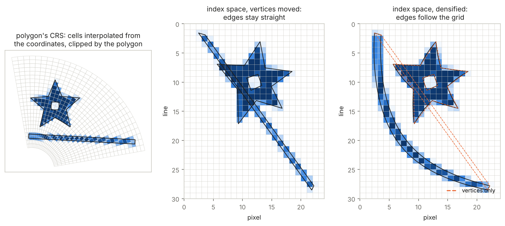
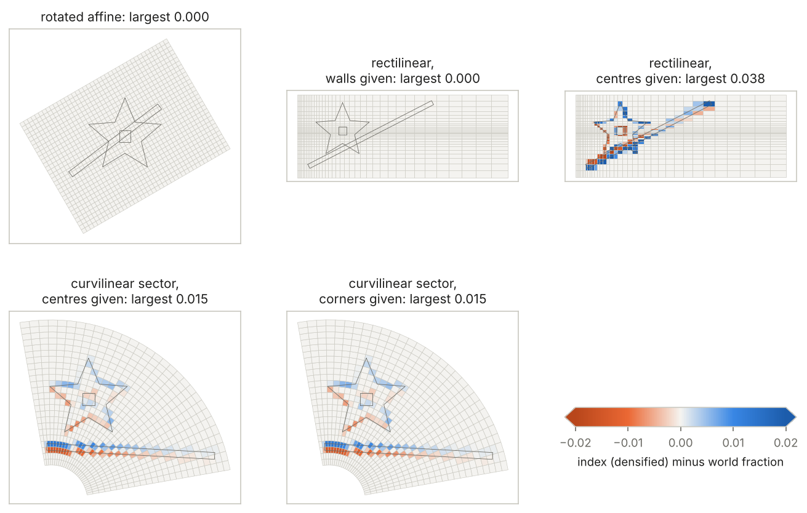
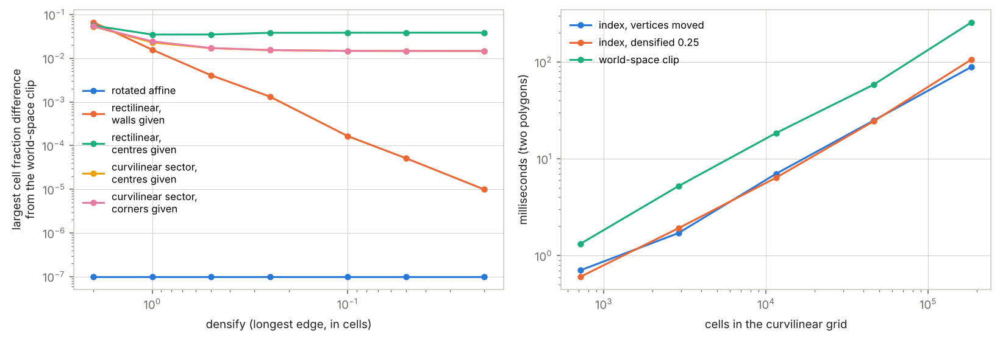

# Coverage on grids that are not a regular lattice

Status: contract, plus discussion. Audience: developers writing a front
end for controlledburn (rwarp, the R and Python bindings, array libraries
such as xarray, rasterix and Zarr-backed data cubes), where grids are
often rotated, rectilinear or curvilinear rather than a regular lattice.

This note is where the grid-geometry plan (#7) lands, following wxylib's
m20 ("movement crates"): controlledburn stays dependency-free and works
in index space; every other grid is a front end outside it, and the
front ends live in rwarp, where transformers, controlledburn and bigcurve
meet. "The contract" below is what controlledburn guarantees and what a
front end must supply. The curvilinear front end's design (cell
definition, folds, poles, tripolar seams, the quad index, the
antimeridian, bigcurve) is in rwarp's `design/curvilinear-frontend.md`
(hypertidy/rwarp, branch `docs/curvilinear-frontend`).

## Summary

controlledburn burns polygons onto a regular lattice and returns sparse
runs of whole cells plus exact coverage fractions for boundary cells. It
does not need to know about any other kind of grid. A small front end,
outside the engine, can move each polygon into the grid's **index space**
(fractional column, row) and burn it on a lattice of unit cells; the
results are then already in the original grid's `(row, col)`.

How exact that is depends only on whether the grid is affine within each
cell:

| grid | front end | result |
|---|---|---|
| regular | none | exact (the engine's own case) |
| rotated or sheared affine | inverse geotransform, vertices only | exact |
| rectilinear (1D coordinates, uneven spacing) | cut edges at cell walls, map each axis | exact |
| curvilinear, bilinear cells (GDAL's geolocation model) | cut edges into short pieces, inverse lookup | close, not exact |
| curvilinear, equal-area cells (new, below) | cut edges at cell sides and four spokes per cell, inverse lookup | exact |
| any of the above, polygon in another CRS | reproject, then as above, with edges cut | as above, to the densify tolerance |

"Exact" here means the fractions match a world-space reference (each cell
outline clipped by the polygon in the polygon's CRS) to the engine's
single precision. On a curvilinear grid read bilinearly, a fraction of a
unit cell is not a fraction of the cell's area, because the bilinear map
is not affine within the cell: the error is around one percent of a cell
on a polar sector, measured below. But the straight-edged quadrilateral
can be mapped onto the unit square differently: split it into four
triangles at the mean of its corners, and each triangle has the same
share of the cell's area in both spaces. The map is then affine on each
triangle with one common scale, and the index-space burn is exact for
the same cells (section "Curvilinear"). So every grid in the table has
an exact front end, and none needs an engine change.

Recommendation on the grid-geometry seam (#8, #7 stages 2 to 4): **do
not pursue it.** Rectilinear grids are exact in a front end (a monotone
map per axis, with a vertex at each wall crossing), and so are
curvilinear ones with equal-area cells. Keeping the engine on unit cells
keeps the C++ port small. The `grid-geometry-stage1` branch can be closed
with a pointer here. What it would have bought (no transform pass,
coordinates kept in their CRS) is speed and precision, not correctness.

## The contract

What controlledburn guarantees, for rings given in **index space**:

- **Exact planar area in index space.** For straight segments between
  the given vertices, coverage fractions are the exact area of the ring
  inside each unit cell, up to floating point: `f32` in `burn`'s edge
  table, `f64` in `CoverageWindow` and `RowPrefix`. Lengths in the line
  table are index-space lengths: a front end rescales them per piece.
- **Nothing about any other space.** controlledburn never sees a CRS, a
  transformer or a curve. If the index-space ring is not the true image
  of the shape, the answer is exact for the wrong ring.

Conventions, which differ between the two engines:

| | `burn` with `GridSpec` | `CoverageWindow`, `RowPrefix` |
|---|---|---|
| frame | world extent, y up; row 0 at the top (`ymax`) | index space, y down: column `i` spans `x` in `[i, i + 1]`, row `j` spans `y` in `[j, j + 1]` |
| index space in that frame | `GridSpec::new(0, -h, w, 0, w, h)` with each vertex's row negated, as in the code above | as given |
| ring orientation | either; normalised internally, holes by ring order | signed: positive for clockwise as drawn with y down; holes must run the other way |
| overlap | non-zero winding | signed sum: a self-overlap counts twice or cancels |
| outside the grid | clipped to the extent | pieces outside the window clamped to its walls; closed rings beside it contribute nothing |
| output | sparse runs and edges, 0-based `(row, col)` | a dense window of fractions, or a boundary integral |

What a front end must do:

1. **Map positions to index space.** Fractional `(col, row)`, row 0 at
   the first row of the grid's arrays.
2. **Make every piece straight in index space.** Insert a vertex
   wherever the world-to-index map changes its affine piece: at every
   cell wall for a rectilinear grid; at every cell side and spoke for
   equal-area curvilinear cells. Where the map is not piecewise affine
   (bilinear cells, a CRS change), densify to a tolerance in cells;
   exactness is then to that tolerance.
3. **Close rings that leave the grid** where the map is undefined
   outside it (curvilinear grids): join exit to re-entry along the
   grid's index-space boundary. The added pieces lie on boundary walls
   and change no cell.
4. **Handle wrap and folds** (periodic longitude, tripolar seams) by
   unwrapping into a wider index space and folding columns back after,
   not by splitting the polygon in the engine.
5. **Weight back to world units** if it wants areas: a fraction times
   the cell's world area. That is exact only when the map preserves area
   ratios within each cell (affine, rectilinear, equal-area cells).

Exactness by grid type:

| grid | affine pieces | vertices the front end inserts | fractions are world-area fractions |
|---|---|---|---|
| affine, any rotation or shear | one | none | yes |
| rectilinear, walls known | one per cell | at walls | yes |
| rectilinear, centres only | one per cell, walls at midpoints | at walls | yes, for the chosen walls |
| curvilinear, equal-area cells | four per cell | at sides and spokes | yes, for straight-edged quads in the grid's CRS |
| curvilinear, two triangles per cell | two per cell | at sides and the diagonal | no, unless the two triangles have equal area |
| curvilinear, bilinear cells | none | densify | no: index-space measure, about 1% of a cell on a polar sector |
| geodesic cells | none | densify | no: needs a spherical measure, out of scope |

## Index space as the common currency

The engine's contract is a regular grid: an extent and a column and row
count, row 0 at the top. Index space is such a grid. With `w` columns and
`h` rows:

```rust
use controlledburn::{burn, BurnOptions, Coord, Geometry, GridSpec, Polygon};

// unit cells, x = col, y = -row (so row 0 is at the top, as the engine expects)
let grid = GridSpec::new(0.0, -(h as f64), w as f64, 0.0, w as u32, h as u32);

// each ring: positions -> fractional (col, row) by the front end, then y negated
let rings: Vec<Vec<Coord>> = polygon
    .iter()
    .map(|r| to_index_ring(r).iter().map(|p| Coord::new(p[0], -p[1])).collect())
    .collect();

let r = burn(&[Geometry::Polygon(Polygon::new(rings))], &grid, BurnOptions::coverage())?;
// r.runs and r.edges carry (row, col) of the original grid, unchanged
```

Everything specific to the grid lives in `to_index_ring`. It has two jobs:

1. map positions to fractional `(col, row)`;
2. cut edges where needed, so that each piece is a straight segment in
   index space (a straight edge in the polygon's CRS is generally a curve
   in index space).



On the left, a curvilinear grid (a polar sector) in its own CRS, cells
shaded by covered fraction. In the middle, the polygons with only their
vertices moved to index space: the long sliver is moved end to end in a
single step and cuts straight across cells it never touches. On the
right, the edges are cut into short pieces first and follow the grid.
Moving vertices alone (what GDAL's rasterizer does when the target is
not a regular lattice in the polygon's CRS) is wrong by whole cells along
long edges on any non-affine grid.

## Grid families

### Rotated or sheared affine

A geotransform `[x0, dx, rx, y0, ry, dy]` with nonzero `rx` or `ry`, as
rasterix's `RasterIndex` can hold. Its inverse maps positions to index
space. An affine map keeps straight lines straight and scales every area
by the same factor, so moving the vertices alone is exact, and the
fractions are fractions of each cell's area. Nothing else is needed.

### Rectilinear

1D coordinates along x and y with uneven spacing: a stretched model grid,
or any `DataArray` whose dimension coordinates are not evenly spaced. The
front end needs cell **walls**. With CF `bounds` they are given. With
centres only, they must be chosen; midpoints between neighbouring centres
(and half a cell beyond each end) are the usual choice. This is a
convention, not a recovery: the true walls cannot be derived from centres
unless the spacing is even.

With walls known, each axis maps linearly within each cell, so the map is
affine within each cell. Cutting every edge where it crosses a wall makes
every piece straight in index space, and the burn is exact, area fractions
included. Each axis maps on its own (a binary search into the walls, then
a linear step), so the front end is a few dozen lines.

### Curvilinear

2D coordinate arrays: swaths, ocean and atmosphere model grids, rotated
pole grids read as 2D longitude and latitude. Two things change.

- **The inverse is a search.** Mapping a position to `(col, row)` means
  finding the cell that holds it (a backmap, a k-d tree, or a walk) and
  inverting the bilinear interpolation inside it. That belongs to the
  front end, or to the library that already holds the coordinates.
- **The measure depends on the cell map.** Read bilinearly (GDAL's
  model, or for an analytic grid whatever the projection is), the map is
  not affine within a cell. Cutting edges into short pieces makes the
  polygon's shape right in index space, but the engine then reports the
  fraction of the unit square covered, which is not the fraction of the
  cell's area.



The difference is zero for rotated affine and for rectilinear grids with
walls given. Given only centres, a rectilinear grid read through bilinear
interpolation of its centres has cells that straddle two interpolation
patches in each direction, and it behaves like a curvilinear one. On the
polar sector the difference is up to 1.5 percent of a cell, largest on
the inner rows where cells are most trapezoidal. Totals stay close
(about 1e-4 of the polygon's area), because the errors along a boundary
partly cancel.



On the left, cutting edges finer converges for rectilinear grids with
walls given and stops improving on the others: what is left is the
measure, not the shape. On the right, cutting edges costs nothing
measurable, and the world-space clip costs a few times the burn.

#### Equal-area cells

Take the cell to be the straight-edged quadrilateral through its four
corners `P00, P10, P11, P01` (bilinear cells have the same sides; they
differ inside). Put a centre `C` at the mean of the four corners and
split the cell into four triangles, one on each side, with apex `C`.
Split the unit square the same way, at the point `(u, v)` with

```text
u = 2 area(P01, P00, C) / A      v = 2 area(P00, P10, C) / A
```

where `A` is the cell's area. Then each unit-square triangle holds the
same share of the square as its world triangle holds of the cell, so the
affine map between each pair scales area by `1 / A`, the same for all
four. Area ratios are preserved within the cell, and index-space
fractions are world-area fractions, exactly.

Why the mean of the corners works: the summed area of the triangles on
the `v = 0` and `v = 1` sides is linear in `C`, and its values at the
midpoints of those two sides add up to `A`. So at their midpoint, which
is the mean of the four corners, it is `A / 2`, and the other two
triangles hold the other half. For a convex cell, `C` is inside and all
four triangles are proper. Non-convex cells need `C` in the cell's
kernel, and a different centre where the mean is not there; the rwarp
note covers that.

The front end cuts each segment where it crosses a cell side or a spoke
(`C` to a corner) and maps each piece's ends by its triangle's affine
map. No root-finding: the inverse within a cell is barycentric. What it
changes compared with the bilinear model is only where points inside a
cell land in index space; cell sides, corners and outlines are the same.

The index-space burn does not replace a world-space clip as a reference,
but with equal-area cells the two agree to single precision.

## Evidence

`examples/grid_frontends.rs` builds a rotated affine grid, a rectilinear
grid and a polar sector (with an analytic inverse, standing in for a
coordinate search), plus the sector's corners as a plain curvilinear grid
of straight-edged quadrilaterals, read bilinearly and with equal-area
cells. It burns a star with a hole and a long sliver on each through the
front ends above, and compares every cell with a world-space clip of the
true cell outline. It depends only on this crate.

```text
cargo run --release --example grid_frontends

grid             polygon  area error, ref area error, burn  largest cell diff      vertices only
rotated affine         0          2.2e-16         -8.9e-10             0.0000             0.0000
rotated affine         1          9.8e-15          -1.8e-9             0.0000             0.0000
rectilinear            0         -4.4e-16          -4.2e-9             0.0000             0.1220
rectilinear            1         -2.3e-15           1.5e-9             0.0000             1.0000
polar sector           0          3.9e-14           1.8e-4             0.0075             0.3065
polar sector           1         -3.4e-14          -1.5e-4             0.0147             0.9954
quads, bilinear        0          1.6e-15           1.8e-4             0.0074             0.3059
quads, bilinear        1          2.7e-15          -1.6e-4             0.0147             0.9955
quads, equal-area      0          1.6e-15          -2.1e-9             0.0000             0.3032
quads, equal-area      1          2.7e-15          -1.7e-9             0.0000             0.9955
```

- "area error, ref": the world-space clip's covered area against the
  polygon's area. It is exact, which validates the reference.
- "area error, burn": the burn's fractions weighted by each cell's world
  area, against the polygon's area.
- "largest cell diff": the largest per-cell difference in fraction
  between the burn (edges cut) and the reference.
- "vertices only": the same with vertices moved alone.

The two quad grids have the same cells; only the map inside each cell
differs. Bilinear cells behave like the analytic sector. Equal-area cells
match the reference as the affine and rectilinear grids do.

The figures for the first three grids come from an independent implementation of the same
two methods (including grids given by centres and by corners), whose
world-space clip agrees with OGR/GEOS intersection areas to 1e-12 of a
cell.

## For array libraries

What each common xarray representation needs from a front end:

| representation | positions to index | edges cut | fractions |
|---|---|---|---|
| affine transform (e.g. rasterix `RasterIndex`), any rotation | inverse affine | no | exact |
| 1D dimension coordinates with CF bounds | per-axis search into walls | at walls | exact |
| 1D dimension coordinates, centres only | as above, walls at midpoints | at walls | exact for the chosen walls |
| 2D coordinates (curvilinear), bilinear cells | cell search plus inverse bilinear | short pieces | index-space |
| 2D coordinates (curvilinear), equal-area cells | cell search plus barycentric inverse | at sides and spokes | exact |

Because results are in the original grid's `(row, col)`, they index
straight into the array (`isel` positions) and into its chunks: a run
`col_start..col_end` on row `r` falls into chunks by integer division,
with no reprojection or resampling of the data. Sparse output means a
zone's weights are the size of its boundary, not of the grid.

A polygon in a different CRS composes with all of this: reproject to the
grid's CRS and map to index space as one function, and cut edges, since a
reprojected straight edge is itself a curve.

## For the engine

1. **No change is required.** Every grid above has a front end of a few
   dozen lines, and the curvilinear one is exact with equal-area cells.
2. **Front ends live in rwarp**, not here (m20): rwarp already depends on
   controlledburn, holds the transformers (a grid's description, for the
   purpose of moving shapes onto it, is its world-to-index transformer)
   and is where bigcurve plugs in. The bindings and array libraries can
   use rwarp's front ends or write their own against the contract above.
3. **No grid-geometry seam.** The `Axis` seam (#8) is not needed for
   correctness; close it with a pointer to this note.
4. **What would still help, inside the contract:** a `Burner` that keeps
   its scratch across calls (many small polygons), and a documented
   `f32` versus `f64` choice for edge fractions (below).

## Open questions

- Fractions are single precision in `burn` (hypertidy/controlledburn#24
  item 8). Front ends that weight by varying world cell areas make the
  truncation visible per cell; `CoverageWindow` is `f64` already.
- Periodic and wrapped grids (global longitude, tripolar folds) are front
  end work (contract item 4); the rwarp note has the design.
- Whether the bindings should call rwarp's front ends or carry their own
  (hypertidy/controlledburn#14).
